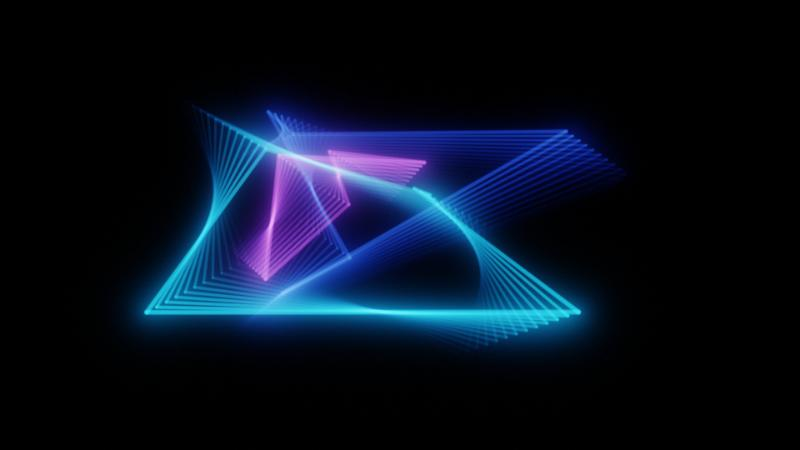

# Light Show

**Live: <https://andreibautin.github.io/light-show/>**

Classic 90s/2000s screensavers, rebuilt in WebGL and played by your music.

Six scenes, all neon on black: **Echoes**, **Starfield**, **Pipes**,
**Ribbons**, **Rain** and **Maze** ([what each does with the music](docs/SCENES.md)).
Feed it the built-in demo track (silent, it only drives the visuals),
**another browser tab** playing Spotify or YouTube, the microphone, or a
file. Auto mode changes scene on a drop, dipping through black. The beat
never strobes the screen.

## Use it

No sign-up and nothing stored: open the live link and pick a sound. **← →** change screensaver, **A** auto,
**F** fullscreen, **H** hide the panel; on a phone, swipe and tap.
`?scene=pipes` links straight to one scene; `?debug` shows frame rate.

**Install it as an app:** in Chrome or Edge, the install icon in the address
bar (or ⋮ → Install). It then opens in its own window and works offline.

## Run it locally

Double-click **`start-app.bat`**: it installs dependencies on first run,
starts the dev server on <http://localhost:5317> and opens the browser. Or
`npm install` then `npm run dev`.

`npm run verify` (typecheck, lint, format, tests with a coverage floor,
build) gates every push and every deploy. Pushing to `main` deploys to
GitHub Pages.

## The idea that makes it work

Every musical decision — band levels, beats, song structure, the flash
safety limit, which scene plays — is a **pure function of the spectrum and a
timestamp** in `src/analysis/`. Scenes never see time directly: they move on
`flow`, a phase the music speeds up but can never make jump. So the
detectors are tested against synthetic tracks instead of by ear, and every
screensaver's trails, pipes and paths are a function of `flow` alone, with
nothing remembered between frames.

## Built with, and why

- **TypeScript, strict** — the analysis core is numeric code where a
  mistyped unit is silent; strict mode and exhaustive switches catch it.
- **Raw WebGL2 and GLSL, no engine** — every scene is one full-screen
  shader; an engine would add weight without helping. The bundle is ~50 KB
  with **no runtime dependencies**.
- **Web Audio `AnalyserNode`** — the browser's FFT is fast and good enough;
  everything after it is this repo's code.
- **Vite, Vitest, ESLint** — fast builds and tests; lint enforces the
  architecture's boundaries, not just style.
- **GitHub Pages** — a static site needs nothing more, and deploys with no
  extra account or secret.

More: [architecture](docs/ARCHITECTURE.md) · [scenes](docs/SCENES.md) ·
[testing](docs/TESTING.md) · [security](docs/SECURITY.md) ·
[deployment](docs/DEPLOYMENT.md) · [interview guide](docs/INTERVIEW_GUIDE.md) ·
[backlog](docs/BACKLOG.md)

## Safety and privacy

Full-screen flashes are limited to 3 per second (WCAG 2.3.1) and switched
off entirely under the OS "reduce motion" setting. Audio never leaves the
browser: there is no server, no analytics and no third-party request, and a
strict Content-Security-Policy keeps it that way.

## License

[MIT](LICENSE).
