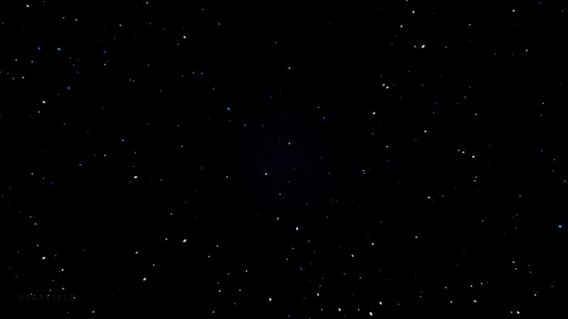
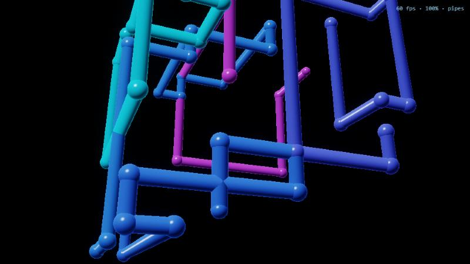
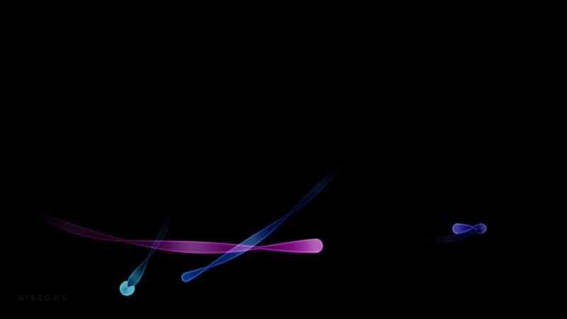
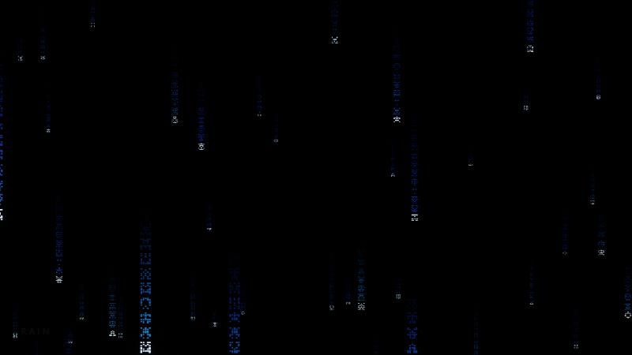
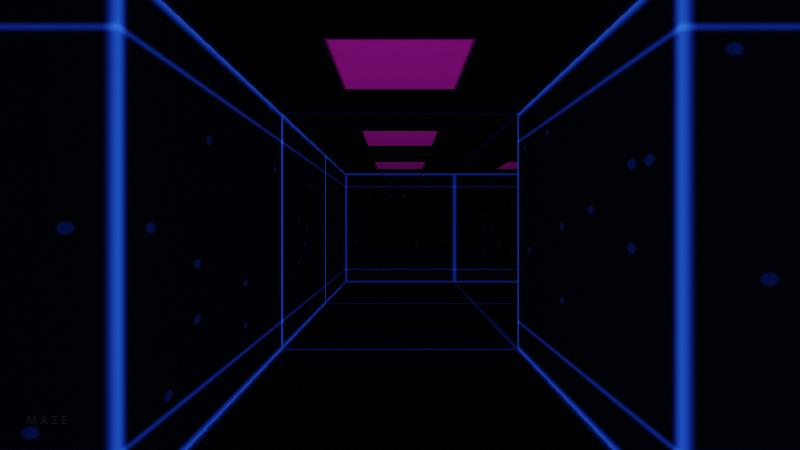

# The screensavers

Every scene reads the same musical state (see `SCALARS` in
`src/render/renderer.ts`) and decides for itself what to do with it. None of
them strobes on the beat: music changes speeds, sizes, colours and trails,
and the only full-screen brightness kick is the rate-limited `uFlash`.

| Scene         | What you see                                                            | Bass                           | Mids                      | Treble                 | Melody (pitch)         | Drop                        |
| ------------- | ----------------------------------------------------------------------- | ------------------------------ | ------------------------- | ---------------------- | ---------------------- | --------------------------- |
| **Echoes**    | Neon polygons bouncing in a turning 3D box, each trailing fading echoes | Size and glow of the big shape | Trail length              | Sparks along the lines | Hue, cyan → magenta    | Shapes thrown outward       |
| **Starfield** | Flight through layered stars                                            | Nebula glow at the centre      | Cruising speed (via flow) | More stars             | Tint of coloured stars | Jump to warp: long streaks  |
| **Pipes**     | Pipes growing through a 3D grid, round after round                      | Pipe thickness                 | Growth speed (via flow)   | Highlight sparkle      | Palette                | Light races along the pipes |
| **Ribbons**   | Twisting flat bands looping through space                               | Band width                     | Trail length              | Glints on the edges    | Palette                | Sheen flares                |
| **Rain**      | Digital rain in three parallax depths                                   | —                              | Fall speed (via flow)     | More columns falling   | Tint                   | Faster fall (via flow)      |
| **Maze**      | First-person walk through neon corridors                                | Wall-line glow                 | Walking speed (via flow)  | Data sparks on panels  | Hue                    | Lines flare                 |

"Via flow" means the scene moves on `uFlow`, the integrated phase that busier
music and drops speed up; see `flowRate` in `src/analysis/show.ts`.

|                                        |                                              |                                  |
| -------------------------------------- | -------------------------------------------- | -------------------------------- |
|  Echoes    |  Starfield |  Pipes |
|  Ribbons |  Rain                |  Maze    |

## How each one works

- **Echoes**: five vertices per shape bounce on triangle waves; an echo is
  the same shape at an earlier flow, so trails cannot jump. Lines are
  distance-to-segment in screen space after projection.
- **Starfield**: fourteen depth slices slide toward the viewer and wrap. Stars
  are pinpoints in screen space with a streak back toward the centre.
- **Pipes**: each pipe is a seeded random walk on a grid, recomputed per
  pixel from how far it has grown. Drawn as tube and ball impostors with a
  depth test, not raymarched.
- **Ribbons**: each band is a point's path sampled backwards in time. The
  nearest segment is found first and shaded once, so joints never show.
- **Rain**: glyphs are 5×7 hashed bit patterns, mirrored so they read as
  characters, in three layers of different column widths.
- **Maze**: the path alternates forward and sideways legs, so it never
  crosses itself; only a window of legs around the camera exists. Walls are
  found by DDA through the grid.

## Adding one

1. Create `src/render/scenes/<id>.ts` exporting a `Scene` whose `fragment`
   is `SCENE_HEADER + your shader`. Read the rules at the top of
   `scenes/common.ts`: move on `uFlow`, never scale time by a level, no
   whole-screen brightening except `uFlash`.
2. Write linear HDR colour to `outColor`; bloom and tonemapping happen after.
3. Register it in `scenes/index.ts`. Lint stops a scene importing anything
   but `./common`.
4. Check it at `?scene=<id>&debug`: the HUD shows fps and render scale.
   Keep per-pixel loops lean: hoist anything constant per frame.
5. Add a row to the table above.
